Wallpaper: the Taj Mahal, Agra. Shot by me.

Android engineer in Noida, India. I build Android apps end to end, from the first screen to the release build. My pinned projects are below.

[LinkedIn](https://www.linkedin.com/in/shubhsingh-) · [Email](mailto:shubh200019@gmail.com)
